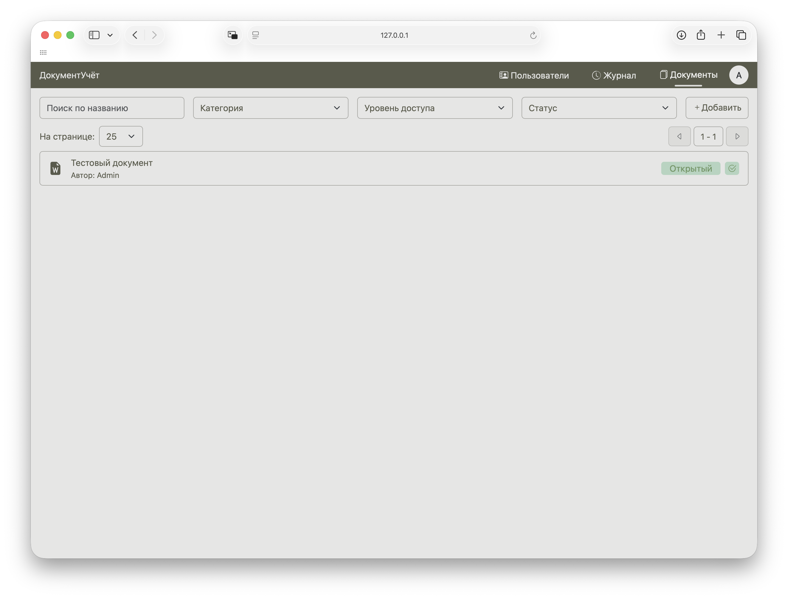
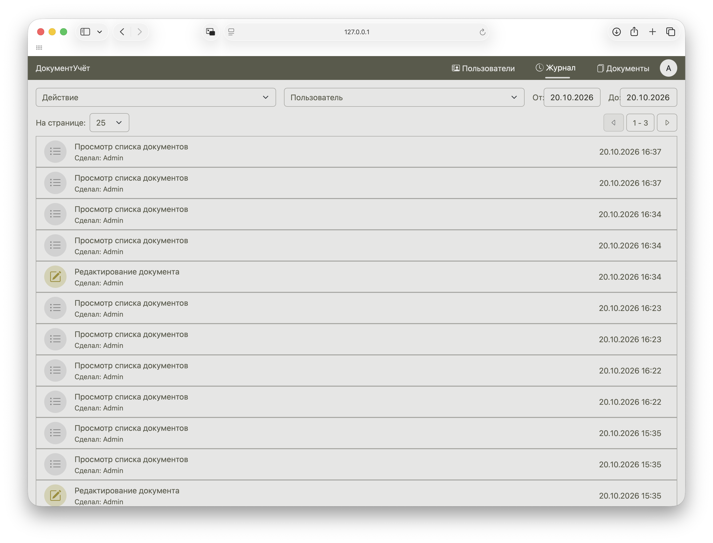

# Enterprise Docs API

Это веб-приложение / сервис для защищенного документооборота.
Оно помогает хранить важные документы, сортировать их, управлять доступом к этим документам и отслеживать действия

## Возможности
- Авторизация пользователей
- Создание пользователей с нужными ролями
- Возможность дополнять в коде роли и настраивать тонко права
- Организация документов с помощью категорий, департамента, регистрационного номера и уровня доступа
- Фильтрация документов и записей в журнале
- Отслеживание действий и сохранение в журнале
- Проверка целостности документа при скачивании
- Шифрование документа при хранении 
- Разные права: создание, удаление, чтение, редактирование, скачивание документа, чтение журнала  и управление пользователями

## Стек
Python, Flask, Flask-Smorest, Flask-Sqlalchemy, cryptography, flask-login, marshmallow

## Как запустить

Скачать python3.10+

 `git clone https://github.com/nanomolydev/Enterprise-docs-API.git`

создаем виртуальное окружение:

Linux/Mac:
```
python3 -m venv .venv
source .venv/bin/activate
```

Windows:
```
python -m venv .venv
.venv\Scripts\activate.bat
```

Устанавливаем зависимости:
`pip install -r requirements.txt`

создать .env по шаблону в .env-example

генерируем два byte ключа для документов и авторизации с помощью `python3 generate.py`
или `python generate.py` на Windows, придумываем логин и пароль

запускаем с помощью команды `flask run`

заходим на страницу `http://127.0.0.1:5000/documents`

Готово!

## Скриншоты


## Модели данных
### UserModel
Пользователь с ролью, документами, логином паролем, полным именем, с возможностью деактивировать и причастностью к определенным действиям в журнале

### RoleModel
Роль с правами, названием и причастностью к определенным пользователям, у роли есть возможность использовать данные права: создание, чтение, скачивание документа, редактирование и удаление своего (принадлежащего пользователю с этой ролью) документа, редактирование и удаление любых документов, управление пользователями, чтение журнала,

### DocModel
Документ включающий в себя: 
* название документа
* регистрационый номер
* дата создания/обновления
* автора
* департамент 
* категорию: 
	* Кадровый документ
	* Финансовый документ
	* Договор
	* Внутренний регламент
	* Техническая документация
* уровень доступа:
	* Открытый
	* Для служебного пользования
	* Конфиденциально
* статус:
	* Активный
	* На согласовании
	* Архив
	* Истёк срок хранения
* срок хранения
* путь до файла
* название файла 
* хэш файла

### AuditlogModel
Журнал с действием, автором, временем, статусом об удачном или неудачном действии, названием документа если действие связано с документом, и регистрационный номер документа

##  Основные эндпоинты

### Авторизация
| Метод | Путь              | Что делает                                                                                                                                          |
| ----- | ----------------- | --------------------------------------------------------------------------------------------------------------------------------------------------- |
| POST  | `/api/login`      | Позволяет войти в нужный аккаунт используя login и password, также создает сессию входа которая действует некоторое время именно с этого устройства |
| POST  | `/api/logout`     | Позволяет выйти из аккаунта                                                                                                                         |
| GET   | `/api/get_myself` | Позволяет получить полное имя текущего пользователя, id, role_id и объект роли                                                                      |

### Документы
| Метод  | Путь                           | Что делает                                       |
| ------ | ------------------------------ | ------------------------------------------------ |
| POST   | `/api/documents`               | Позволяет создать документ                       |
| GET    | `/api/documents`               | Позволяет получить все доступные документы       |
| GET    | `/api/documents/<id>`          | Позволяет получить определенный документ         |
| PATCH  | `/api/documents/<id>`          | Позволяет изменить определенный документ         |
| DELETE | `/api/documents/<id>`          | Позволяет удалить определенный документ          |
| GET    | `/api/documents/<id>/download` | Позволяет скачать определенный документ          |
| GET    | `/api/documents/count`         | Позволяет узнать количество доступных документов |

### Пользователи и роли
| Метод | Путь              | Что делает                                                                         |
| ----- | ----------------- | ---------------------------------------------------------------------------------- |
| POST  | `/api/users`      | Позволяет создать пользователя                                                     |
| GET   | `/api/users`      | Позволяет получить список всех пользователей                                       |
| GET   | `/api/users/<id>` | Позволяет получить определенного пользователя                                      |
| PATCH | `/api/users/<id>` | Позволяет изменить полное имя, роль и статус активности определенного пользователя |
| GET   | `/api/roles`      | Позволяет получить список ролей                                                    |

### Журнал действий
| Метод | Путь              | Что делает                              |
| ----- | ----------------- | --------------------------------------- |
| GET   | `/api/logs`       | Позволяет получить список событий       |
| GET   | `/api/logs/<id>`  | Позволяет получить определенное событие |
| GET   | `/api/logs/count` | Позволяет получить количество событий   |

Веб-интерфейс: `/login`, `/documents`, `/users`, `/logs`

## Что было интересно сделать

Было интересно попробовать шифрование файлов и обратную расшифровку
Также было интересно разобраться с проверкой целостности и сохранением хэша
Ещё было интересно разобраться с Flask-Login и то как он позволяет создавать сессии входа и защищать таким образом сервис
Также было интересно попробовать снова вёрстку и приблизиться к пониманию работы css и разметки